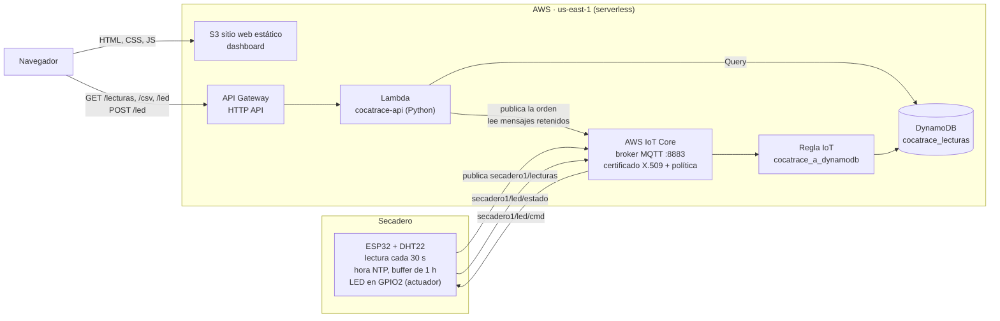

# CocaTrace Serverless: ESP32 → AWS IoT Core → DynamoDB, con dashboard en S3

Práctica 3 de *Inteligencia Artificial aplicada a IoT* (Especialización en IA): **arquitectura serverless para IoT**.

Un ESP32 con un sensor DHT22 mide la **temperatura y la humedad del secadero de hoja de coca** y las envía por **MQTT seguro (TLS + certificados X.509)** a **AWS IoT Core**. Una **regla de IoT** guarda cada lectura en **Amazon DynamoDB**. El **dashboard** está alojado en **Amazon S3** como sitio web estático y consulta los datos a través de **API Gateway + AWS Lambda**. Desde el dashboard se puede **encender y apagar un actuador** (el LED del ESP32, que representa el ventilador del secadero) y **descargar las lecturas en CSV**.

No hay servidores que administrar: todos los servicios son administrados por AWS y se cobran por uso.

Es parte del proyecto de trazabilidad de bioproductos de hoja de coca (Minciencias): cada lectura queda asociada al secadero y a su hora real de medición.

**Dashboard:** http://cocatrace-dashboard-870778468527.s3-website-us-east-1.amazonaws.com

## Arquitectura



| Servicio | Recurso | Función |
|---|---|---|
| AWS IoT Core | thing `esp32-secadero-01`, política `cocatrace-esp32` | Broker MQTT administrado; autentica al ESP32 con su certificado |
| Regla de IoT | `cocatrace_a_dynamodb` | Toma cada mensaje de `+/lecturas`, lo valida y lo escribe en DynamoDB |
| DynamoDB | tabla `cocatrace_lecturas` (bajo demanda) | Base de datos de las lecturas |
| Lambda | `cocatrace-api` (Python 3.13) | API del dashboard: datos, CSV y control del LED |
| API Gateway | HTTP API `cocatrace-api` | URL pública HTTPS de la Lambda, con CORS |
| S3 | bucket `cocatrace-dashboard-870778468527` | Aloja el dashboard como sitio web estático |

**¿Por qué una Lambda entre el dashboard y DynamoDB?** El dashboard es una página estática: si consultara DynamoDB directamente, tendría que llevar credenciales de AWS dentro del JavaScript, visibles para cualquiera. La Lambda tiene los permisos y el dashboard solo conoce la URL de la API.

## Topics MQTT

| Topic | Mensaje | Quién publica |
|---|---|---|
| `secadero1/lecturas` | `{"temperatura": 23.7, "humedad": 71.9, "ts": 1794009632}` | ESP32, cada 30 s |
| `secadero1/led/cmd` | `{"led": "on", "ts": ...}` (retenido) | Lambda, cuando se pulsa un botón del dashboard |
| `secadero1/led/estado` | `{"led": "on", "ts": ...}` (retenido) | ESP32, para confirmar que aplicó la orden |
| `secadero1/estado` | `conectado` / `desconectado` (retenido) | ESP32; AWS IoT publica `desconectado` si el ESP32 se cae (*Last Will*) |

- `ts` es la hora real de la medición (epoch UTC, sincronizada por NTP). Si el ESP32 pierde la conexión, guarda hasta 120 lecturas (1 hora) y las envía al reconectarse con su hora correcta.
- La orden del LED es un **mensaje retenido**: si el ESP32 está desconectado cuando se pulsa el botón, la recibe al volver a conectarse. También recupera el estado del LED después de un reinicio.
- El dashboard muestra el LED como encendido solo cuando el ESP32 **confirma** el cambio en `led/estado`, no cuando se envía la orden.

## Base de datos (DynamoDB)

Tabla `cocatrace_lecturas`, modo de capacidad **bajo demanda**:

| Atributo | Tipo | Clave | Ejemplo |
|---|---|---|---|
| `secadero` | String | Partición | `secadero1` |
| `ts` | Number | Ordenación | `1794009632` (hora de medición, epoch UTC) |
| `temperatura` | Number | | `23.7` |
| `humedad` | Number | | `71.9` |
| `recibido` | Number | | hora de llegada a AWS IoT |

Con esta clave, "las lecturas del secadero 1 entre dos fechas" es una sola consulta (`Query`) ordenada por tiempo. Si una lectura del buffer llega dos veces, se sobrescribe a sí misma: no hay duplicados.

La regla de IoT descarta lecturas sin hora NTP y valores fuera del rango del DHT22:

```sql
SELECT topic(1) AS secadero, ts, temperatura, humedad, floor(timestamp() / 1000) AS recibido
FROM '+/lecturas'
WHERE ts > 1700000000 AND temperatura >= -40 AND temperatura <= 80 AND humedad >= 0 AND humedad <= 100
```

## API (API Gateway + Lambda)

| Ruta | Respuesta |
|---|---|
| `GET /lecturas?horas=24` | Lecturas del período en JSON (máximo 720 puntos para las gráficas) |
| `GET /csv?horas=24` | Archivo CSV con todas las lecturas: `fecha_utc, fecha_colombia, secadero, temperatura_c, humedad_pct` |
| `GET /led` | Estado confirmado del LED y conexión del ESP32 |
| `POST /led` | `{"led": "on"}` o `{"led": "off"}` con la cabecera `x-clave-control` |

## Seguridad

- **ESP32 ↔ AWS IoT:** MQTT sobre **TLS** (puerto 8883) con **certificado X.509** propio del dispositivo. Sin el certificado no se puede conectar.
- **Política de IoT con el mínimo permiso** ([`aws/iot-policy.json`](aws/iot-policy.json)): el certificado solo puede conectarse con el client id `esp32-secadero-01`, publicar en sus tres topics y suscribirse a `secadero1/led/cmd`.
- **Actuador protegido:** la API rechaza las órdenes sin la **clave de control** (401). La clave no está en el código: se escribe en el dashboard y se guarda en una variable de entorno de la Lambda.
- **S3:** solo permite **leer** los archivos del dashboard (`s3:GetObject`); nadie puede subir ni borrar.
- **Sin claves en el repositorio:** los certificados y el WiFi van en `firmware/cocatrace_iot/config.h`, que está en `.gitignore`.
- **AWS Academy:** el Learner Lab no permite crear roles de IAM, así que la regla de IoT y la Lambda usan el rol `LabRole`.

## Estructura

```
firmware/cocatrace_iot/   Código del ESP32 (Arduino) + config.example.h
aws/iot-policy.json       Política de AWS IoT del ESP32
aws/iot-rule.json         Regla IoT -> DynamoDB
lambda/api.py             API del dashboard (Lambda)
dashboard/                Dashboard: index.html, styles.css, app.js, config.js
```

## Paso a paso

Todo se hizo con la **AWS CLI v2** en la región `us-east-1`, con las credenciales del Learner Lab (*AWS Details → AWS CLI → Show*, copiadas en `~/.aws/credentials`). Se usa `ACCOUNT_ID` para el número de la cuenta (`aws sts get-caller-identity`).

### 1. Tabla de DynamoDB

```bash
aws dynamodb create-table --table-name cocatrace_lecturas \
  --attribute-definitions AttributeName=secadero,AttributeType=S AttributeName=ts,AttributeType=N \
  --key-schema AttributeName=secadero,KeyType=HASH AttributeName=ts,KeyType=RANGE \
  --billing-mode PAY_PER_REQUEST
```

### 2. Thing, certificado y política en AWS IoT Core

```bash
aws iot create-thing --thing-name esp32-secadero-01
aws iot create-keys-and-certificate --set-as-active \
  --certificate-pem-outfile certificate.pem.crt --private-key-outfile private.pem.key \
  --public-key-outfile public.pem.key            # anota el certificateArn
curl -o AmazonRootCA1.pem https://www.amazontrust.com/repository/AmazonRootCA1.pem

# aws/iot-policy.json con REGION y ACCOUNT_ID reemplazados
aws iot create-policy --policy-name cocatrace-esp32 --policy-document file://iot-policy.json
aws iot attach-policy --policy-name cocatrace-esp32 --target <certificateArn>
aws iot attach-thing-principal --thing-name esp32-secadero-01 --principal <certificateArn>

aws iot describe-endpoint --endpoint-type iot:Data-ATS   # va en config.h y en la Lambda
```

### 3. Regla de IoT → DynamoDB

```bash
aws logs create-log-group --log-group-name /cocatrace/iot-errores
# aws/iot-rule.json con ACCOUNT_ID reemplazado
aws iot create-topic-rule --rule-name cocatrace_a_dynamodb --topic-rule-payload file://iot-rule.json
```

Prueba sin el ESP32 (en la consola: *AWS IoT → MQTT test client → Publish*, o con la CLI):

```bash
aws iot-data publish --topic prueba/lecturas --cli-binary-format raw-in-base64-out \
  --payload '{"temperatura":25.3,"humedad":65.1,"ts":1794008218}' --endpoint-url https://<endpoint>
aws dynamodb query --table-name cocatrace_lecturas --key-condition-expression "secadero = :s" \
  --expression-attribute-values '{":s":{"S":"prueba"}}'
```

### 4. Lambda y API Gateway

```bash
zip api.zip -j lambda/api.py
aws lambda create-function --function-name cocatrace-api --runtime python3.13 --handler api.handler \
  --role arn:aws:iam::ACCOUNT_ID:role/LabRole --zip-file fileb://api.zip --timeout 15 --memory-size 256 \
  --environment 'Variables={TABLA=cocatrace_lecturas,SECADERO=secadero1,IOT_ENDPOINT=<endpoint>,CLAVE_CONTROL=<clave>}'

aws apigatewayv2 create-api --name cocatrace-api --protocol-type HTTP --target <arn-de-la-lambda> \
  --cors-configuration 'AllowOrigins=*,AllowMethods=GET,POST,OPTIONS,AllowHeaders=content-type,x-clave-control'
aws lambda add-permission --function-name cocatrace-api --statement-id apigateway-invoke \
  --action lambda:InvokeFunction --principal apigateway.amazonaws.com \
  --source-arn "arn:aws:execute-api:us-east-1:ACCOUNT_ID:<api-id>/*"
```

La clave de control se generó con `openssl rand -base64 18`.

### 5. Dashboard en S3

Poner la URL de la API (`https://<api-id>.execute-api.us-east-1.amazonaws.com`) en `dashboard/config.js` y luego:

```bash
B=cocatrace-dashboard-ACCOUNT_ID
aws s3api create-bucket --bucket $B
aws s3api put-public-access-block --bucket $B --public-access-block-configuration \
  BlockPublicAcls=true,IgnorePublicAcls=true,BlockPublicPolicy=false,RestrictPublicBuckets=false
aws s3api put-bucket-policy --bucket $B --policy '{"Version":"2012-10-17","Statement":[{"Effect":"Allow","Principal":"*","Action":"s3:GetObject","Resource":"arn:aws:s3:::'$B'/*"}]}'
aws s3 website s3://$B/ --index-document index.html
aws s3 sync dashboard/ s3://$B/ --cache-control no-cache --delete
```

El sitio queda en `http://<bucket>.s3-website-us-east-1.amazonaws.com`.

### 6. ESP32

1. Copiar `firmware/cocatrace_iot/config.example.h` como `config.h` y poner el WiFi (2,4 GHz), el endpoint de IoT y el contenido de `AmazonRootCA1.pem`, `certificate.pem.crt` y `private.pem.key`.
2. Librerías: `PubSubClient` (Nick O'Leary) y `DHT sensor library` (Adafruit). Placa: *ESP32 Dev Module*.
3. Conexión del DHT22: `+` → 3V3, `out` → GPIO4, `−` → GND. El actuador es el LED integrado (GPIO2).
4. En el Serial Monitor (115200 baudios) debe aparecer:

```
Conectando a AWS IoT a24ziw5cccntg8-ats.iot.us-east-1.amazonaws.com... OK
T = 23.7 °C   HR = 71.9 %
PUB secadero1/lecturas {"temperatura":23.7,"humedad":71.9,"ts":1794009632} -> OK
```

## Verificación

| Qué | Cómo |
|---|---|
| El ESP32 está conectado | AWS IoT → *MQTT test client* → suscribirse a `secadero1/#` |
| Los datos están en la base de datos | DynamoDB → `cocatrace_lecturas` → *Explore items* |
| Dashboard | Abrir la URL de S3: valores actuales, gráficas, tabla, estado "ESP32 conectado" |
| Actuador | Escribir la clave y pulsar *Encender*: el LED azul del ESP32 se prende y el dashboard muestra la confirmación |
| CSV | Botón *Descargar CSV* |
| Sin clave no se controla el LED | `curl -X POST <api>/led -d '{"led":"on"}'` → `401` |

## Limpieza

Para no consumir créditos al terminar el curso: borrar el bucket S3 (`aws s3 rb s3://<bucket> --force`), la API, la Lambda, la regla, la tabla, y en IoT desactivar y borrar el certificado, la política y el thing.
